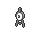

<!-- This file is generated by tools/generate_site.py. Edit the generator, not this file. -->

# Cave of Origin Other

## Walking — Lv. 5 - 75

| Pokémon | Type | Rate |
| --- | --- | --- |
| { .icon loading=lazy } [Unown](../pokemon/201.md) | Psychic | — |

## Horde — Lv. 5 - 75

| Pokémon | Type | Rate |
| --- | --- | --- |
| { .icon loading=lazy } [Unown](../pokemon/201.md) | Psychic | — |

---

[:material-arrow-left: Cave of Origin 1F](cave_of_origin_1f.md) · [All areas](index.md) · [Soaring in the Sky :material-arrow-right:](soaring_in_the_sky.md)
