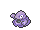

<!-- This file is generated by tools/generate_site.py. Edit the generator, not this file. -->

# Fiery Path

## Grass — Lv. 23

| Pokémon | Type | Rate |
| --- | --- | --- |
| { .icon loading=lazy } [Diglett](../pokemon/050.md) | Ground | 10% |
| { .icon loading=lazy } [Grimer](../pokemon/088.md) | Poison | 10% |
| { .icon loading=lazy } [Koffing](../pokemon/109.md) | Poison | 10% |
| { .icon loading=lazy } [Dunsparce](../pokemon/206.md) | Normal Fairy | 10% |
| { .icon loading=lazy } [Slugma](../pokemon/218.md) | Fire | 10% |
| { .icon loading=lazy } [Numel](../pokemon/322.md) | Fire Ground | 10% |
| { .icon loading=lazy } [Torkoal](../pokemon/324.md) | Fire | 10% |
| { .icon loading=lazy } [Shuppet](../pokemon/353.md) | Ghost | 10% |
| { .icon loading=lazy } [Duskull](../pokemon/355.md) | Ghost | 10% |
| { .icon loading=lazy } [Litwick](../pokemon/607.md) | Ghost Fire | 10% |

## DexNav — Lv. 50

| Pokémon | Type | Rate |
| --- | --- | --- |
| { .icon loading=lazy } [Magcargo](../pokemon/219.md) | Fire Rock | — |

## Horde — Lv. 15

| Pokémon | Type | Rate |
| --- | --- | --- |
| { .icon loading=lazy } [Dunsparce](../pokemon/206.md) | Normal Fairy | — |

---

[:material-arrow-left: Route 112 South](route_112_south.md) · [All areas](index.md) · [Route 112 North :material-arrow-right:](route_112_north.md)
