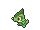

<!-- This file is generated by tools/generate_site.py. Edit the generator, not this file. -->

# Granite Cave B1F

## Walking — Lv. 18

| Pokémon | Type | Rate |
| --- | --- | --- |
| { .icon loading=lazy } [Kadabra](../pokemon/064.md) | Psychic | 10% |
| { .icon loading=lazy } [Onix](../pokemon/095.md) | Rock Ground | 10% |
| { .icon loading=lazy } [Cubone](../pokemon/104.md) | Ground | 10% |
| { .icon loading=lazy } [Rhyhorn](../pokemon/111.md) | Ground Rock | 10% |
| { .icon loading=lazy } [Makuhita](../pokemon/296.md) | Fighting | 10% |
| { .icon loading=lazy } [Sableye](../pokemon/302.md) | Dark Ghost | 10% |
| { .icon loading=lazy } [Mawile](../pokemon/303.md) | Steel Fairy | 10% |
| { .icon loading=lazy } [Aron](../pokemon/304.md) | Steel Rock | 10% |
| { .icon loading=lazy } [Roggenrola](../pokemon/524.md) | Rock | 10% |
| { .icon loading=lazy } [Axew](../pokemon/610.md) | Dragon | 10% |

## DexNav — Lv. 50

| Pokémon | Type | Rate |
| --- | --- | --- |
| { .icon loading=lazy } [Probopass](../pokemon/476.md) | Rock Steel | — |

## Horde — Lv. 12

| Pokémon | Type | Rate |
| --- | --- | --- |
| { .icon loading=lazy } [Zubat](../pokemon/041.md) | Poison Flying | — |

---

[:material-arrow-left: Route 117](route_117.md) · [All areas](index.md) · [Granite Cave B2F :material-arrow-right:](granite_cave_b2f.md)
