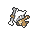
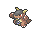
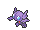
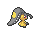
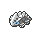
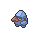
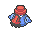

<!-- This file is generated by tools/generate_site.py. Edit the generator, not this file. -->

# Granite Cave B2F

!!! tip "Trainers"

    This area also has trainer battles: see [Granite Cave B2F trainers](../trainers/granite_cave_b2f.md).

## Walking — Lv. 20

| Pokémon | Type | Rate |
| --- | --- | --- |
| { .icon loading=lazy } [Kadabra](../pokemon/064.md) | Psychic | 10% |
| { .icon loading=lazy } [Graveler](../pokemon/075.md) | Rock Ground | 10% |
| { .icon loading=lazy } [Marowak](../pokemon/105.md) | Ground | 10% |
| { .icon loading=lazy } [Kangaskhan](../pokemon/115.md) | Normal | 10% |
| { .icon loading=lazy } [Steelix](../pokemon/208.md) | Steel Ground | 10% |
| { .icon loading=lazy } [Hariyama](../pokemon/297.md) | Fighting | 10% |
| { .icon loading=lazy } [Sableye](../pokemon/302.md) | Dark Ghost | 10% |
| { .icon loading=lazy } [Mawile](../pokemon/303.md) | Steel Fairy | 10% |
| { .icon loading=lazy } [Lairon](../pokemon/305.md) | Steel Rock | 10% |
| { .icon loading=lazy } [Boldore](../pokemon/525.md) | Rock | 10% |

## Rock Smash — Lv. 20

| Pokémon | Type | Rate |
| --- | --- | --- |
| { .icon loading=lazy } [Nosepass](../pokemon/299.md) | Rock | — |

## DexNav — Lv. 50

| Pokémon | Type | Rate |
| --- | --- | --- |
| { .icon loading=lazy } [Probopass](../pokemon/476.md) | Rock Steel | — |

## Horde — Lv. 12

| Pokémon | Type | Rate |
| --- | --- | --- |
| { .icon loading=lazy } [Zubat](../pokemon/041.md) | Poison Flying | — |

---

[:material-arrow-left: Granite Cave B1F](granite_cave_b1f.md) · [All areas](index.md) · [Route 111 :material-arrow-right:](route_111.md)
