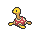

<!-- This file is generated by tools/generate_site.py. Edit the generator, not this file. -->

# Lilycove City

!!! tip "Trainers"

    This area also has trainer battles: see [Lilycove City trainers](../trainers/lilycove_city.md).

## Rock Smash — Lv. 45

| Pokémon | Type | Rate |
| --- | --- | --- |
| { .icon loading=lazy } [Shuckle](../pokemon/213.md) | Bug Rock | — |
| { .icon loading=lazy } [Crustle](../pokemon/558.md) | Bug Rock | — |
| { .icon loading=lazy } [Barbaracle](../pokemon/689.md) | Rock Water | — |

## Surfing — Lv. 40 - 50

| Pokémon | Type | Rate |
| --- | --- | --- |
| { .icon loading=lazy } [Alomomola](../pokemon/594.md) | Water | — |

## Old Rod — Lv. 15

| Pokémon | Type | Rate |
| --- | --- | --- |
| { .icon loading=lazy } [Staryu](../pokemon/120.md) | Water | — |
| { .icon loading=lazy } [Clamperl](../pokemon/366.md) | Water | — |
| { .icon loading=lazy } [Corsola](../pokemon/222.md) | Water Rock | — |

## Good Rod — Lv. 35

| Pokémon | Type | Rate |
| --- | --- | --- |
| { .icon loading=lazy } [Staryu](../pokemon/120.md) | Water | — |
| { .icon loading=lazy } [Clamperl](../pokemon/366.md) | Water | — |
| { .icon loading=lazy } [Corsola](../pokemon/222.md) | Water Rock | — |

## Super Rod — Lv. 55

| Pokémon | Type | Rate |
| --- | --- | --- |
| { .icon loading=lazy } [Starmie](../pokemon/121.md) | Water Psychic | — |
| { .icon loading=lazy } [Gorebyss](../pokemon/368.md) | Water | — |
| { .icon loading=lazy } [Corsola](../pokemon/222.md) | Water Rock | — |

---

[:material-arrow-left: Mt. Pyre Summit 2](mt_pyre_summit_2.md) · [All areas](index.md) · [Magma Hideout :material-arrow-right:](magma_hideout.md)
