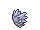
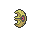
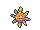
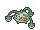
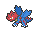
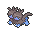

<!-- This file is generated by tools/generate_site.py. Edit the generator, not this file. -->

# Meteor Falls B1F

!!! tip "Trainers"

    This area also has trainer battles: see [Meteor Falls B1F trainers](../trainers/meteor_falls_b1f.md).

## Walking — Lv. 59

| Pokémon | Type | Rate |
| --- | --- | --- |
| { .icon loading=lazy } [Clefairy](../pokemon/035.md) | Fairy | 10% |
| { .icon loading=lazy } [Golbat](../pokemon/042.md) | Poison Flying | 10% |
| { .icon loading=lazy } [Pupitar](../pokemon/247.md) | Rock Ground | 10% |
| { .icon loading=lazy } [Lunatone](../pokemon/337.md) | Rock Psychic | 10% |
| { .icon loading=lazy } [Solrock](../pokemon/338.md) | Rock Psychic | 10% |
| { .icon loading=lazy } [Shelgon](../pokemon/372.md) | Dragon | 10% |
| { .icon loading=lazy } [Metang](../pokemon/375.md) | Steel Psychic | 10% |
| { .icon loading=lazy } [Ferrothorn](../pokemon/598.md) | Grass Steel | 10% |
| { .icon loading=lazy } [Druddigon](../pokemon/621.md) | Dragon | 5% |
| { .icon loading=lazy } [Zweilous](../pokemon/634.md) | Dark Dragon | 10% |
| { .icon loading=lazy } [Carbink](../pokemon/703.md) | Rock Fairy | 5% |

## DexNav — Lv. 60

| Pokémon | Type | Rate |
| --- | --- | --- |
| { .icon loading=lazy } [Crobat](../pokemon/169.md) | Poison Flying | — |

## Horde — Lv. 37

| Pokémon | Type | Rate |
| --- | --- | --- |
| { .icon loading=lazy } [Clefairy](../pokemon/035.md) | Fairy | — |

## Surfing — Lv. 55 - 65

| Pokémon | Type | Rate |
| --- | --- | --- |
| { .icon loading=lazy } [Golbat](../pokemon/042.md) | Poison Flying | — |
| { .icon loading=lazy } [Lunatone](../pokemon/337.md) | Rock Psychic | — |

## Old Rod — Lv. 15

| Pokémon | Type | Rate |
| --- | --- | --- |
| { .icon loading=lazy } [Dratini](../pokemon/147.md) | Dragon | — |

## Good Rod — Lv. 35

| Pokémon | Type | Rate |
| --- | --- | --- |
| { .icon loading=lazy } [Dratini](../pokemon/147.md) | Dragon | — |

## Super Rod — Lv. 55

| Pokémon | Type | Rate |
| --- | --- | --- |
| { .icon loading=lazy } [Dragonair](../pokemon/148.md) | Dragon | — |

---

[:material-arrow-left: Meteor Falls 1F-2](meteor_falls_1f_2.md) · [All areas](index.md) · [Meteor Falls B1F-2 :material-arrow-right:](meteor_falls_b1f_2.md)
