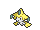
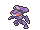
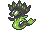
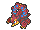

<!-- This file is generated by tools/generate_site.py. Edit the generator, not this file. -->

# Mirage Cave (Any)

Post Game

!!! info "Hint"

    580 BST Pokémon are Lv. 65. 600 BST Pokémon are Lv. 68. Anything higher is Lv. 70.

## Walking — Lv. 65 - 70

| Pokémon | Type | Rate |
| --- | --- | --- |
| { .icon loading=lazy } [Mewtwo](../pokemon/150.md) | Psychic | 5% |
| { .icon loading=lazy } [Kyogre](../pokemon/382.md) | Water | 10% |
| { .icon loading=lazy } [Groudon](../pokemon/383.md) | Ground | 10% |
| { .icon loading=lazy } [Jirachi](../pokemon/385.md) | Steel Psychic | 10% |
| { .icon loading=lazy } [Uxie](../pokemon/480.md) | Psychic Fairy | 10% |
| { .icon loading=lazy } [Mesprit](../pokemon/481.md) | Psychic Fairy | 10% |
| { .icon loading=lazy } [Azelf](../pokemon/482.md) | Psychic Fairy | 10% |
| { .icon loading=lazy } [Genesect](../pokemon/649.md) | Bug Steel | 10% |
| { .icon loading=lazy } [Zygarde](../pokemon/718.md) | Dragon Ground | 5% |
| { .icon loading=lazy } [Diancie](../pokemon/719.md) | Rock Fairy | 10% |
| { .icon loading=lazy } [Volcanion](../pokemon/721.md) | Fire Water | 10% |

## Rock Smash — Lv. 60

| Pokémon | Type | Rate |
| --- | --- | --- |
| { .icon loading=lazy } [Ditto](../pokemon/132.md) | Normal | — |

---

[:material-arrow-left: Mirage Forest (Any)](mirage_forest_any.md) · [All areas](index.md) · [Mirage Mountain (Any) :material-arrow-right:](mirage_mountain_any.md)
