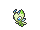
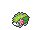
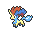
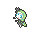
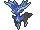

<!-- This file is generated by tools/generate_site.py. Edit the generator, not this file. -->

# Mirage Forest (Any)

Post Game

!!! info "Hint"

    580 BST Pokémon are Lv. 65. 600 BST Pokémon are Lv. 68. Anything higher is Lv. 70.

## Grass — Lv. 65 - 70

| Pokémon | Type | Rate |
| --- | --- | --- |
| { .icon loading=lazy } [Raikou](../pokemon/243.md) | Electric | 10% |
| { .icon loading=lazy } [Entei](../pokemon/244.md) | Fire | 10% |
| { .icon loading=lazy } [Suicune](../pokemon/245.md) | Water | 10% |
| { .icon loading=lazy } [Celebi](../pokemon/251.md) | Psychic Grass | 5% |
| { .icon loading=lazy } [Shaymin](../pokemon/492.md) | Grass | 10% |
| { .icon loading=lazy } [Cobalion](../pokemon/638.md) | Steel Fighting | 10% |
| { .icon loading=lazy } [Terrakion](../pokemon/639.md) | Rock Fighting | 10% |
| { .icon loading=lazy } [Virizion](../pokemon/640.md) | Grass Fighting | 10% |
| { .icon loading=lazy } [Keldeo](../pokemon/647.md) | Water Fighting | 10% |
| { .icon loading=lazy } [Meloetta](../pokemon/648.md) | Normal Psychic | 10% |
| { .icon loading=lazy } [Xerneas](../pokemon/716.md) | Fairy | 5% |

## Rock Smash — Lv. 60

| Pokémon | Type | Rate |
| --- | --- | --- |
| { .icon loading=lazy } [Ditto](../pokemon/132.md) | Normal | — |

---

[:material-arrow-left: Battle Resort](battle_resort.md) · [All areas](index.md) · [Mirage Cave (Any) :material-arrow-right:](mirage_cave_any.md)
