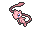
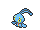
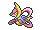
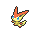

<!-- This file is generated by tools/generate_site.py. Edit the generator, not this file. -->

# Mirage Island (Any)

Post Game

!!! info "Hint"

    580 BST Pokémon are Lv. 65. 600 BST Pokémon are Lv. 68. Anything higher is Lv. 70.

## Grass — Lv. 65 - 68

| Pokémon | Type | Rate |
| --- | --- | --- |
| { .icon loading=lazy } [Mew](../pokemon/151.md) | Psychic | 5% |
| { .icon loading=lazy } [Latias](../pokemon/380.md) | Dragon Psychic | 10% |
| { .icon loading=lazy } [Latios](../pokemon/381.md) | Dragon Psychic | 10% |
| { .icon loading=lazy } [Manaphy](../pokemon/490.md) | Water | 10% |
| { .icon loading=lazy } [Cresselia](../pokemon/488.md) | Psychic | 10% |
| { .icon loading=lazy } [Darkrai](../pokemon/491.md) | Dark | 10% |
| { .icon loading=lazy } [Victini](../pokemon/494.md) | Psychic Fire | 10% |
| { .icon loading=lazy } [Tornadus](../pokemon/641.md) | Flying | 10% |
| { .icon loading=lazy } [Thundurus](../pokemon/642.md) | Electric Flying | 10% |
| { .icon loading=lazy } [Landorus](../pokemon/645.md) | Ground Flying | 10% |
| { .icon loading=lazy } [Hoopa](../pokemon/720.md) | Psychic Ghost | 5% |

## Rock Smash — Lv. 50

| Pokémon | Type | Rate |
| --- | --- | --- |
| { .icon loading=lazy } [Ditto](../pokemon/132.md) | Normal | — |

---

[:material-arrow-left: Mirage Mountain (Any)](mirage_mountain_any.md) · [All areas](index.md)
