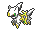
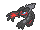

<!-- This file is generated by tools/generate_site.py. Edit the generator, not this file. -->

# Mirage Mountain (Any)

Post Game

!!! info "Hint"

    580 BST Pokémon are Lv. 65. 600 BST Pokémon are Lv. 68. 670/680 BST Pokémon are Lv. 70. 720 BST Pokémon are Lv. 80.

## Grass — Lv. 65 - 80

| Pokémon | Type | Rate |
| --- | --- | --- |
| { .icon loading=lazy } [Articuno](../pokemon/144.md) | Ice Flying | 10% |
| { .icon loading=lazy } [Zapdos](../pokemon/145.md) | Electric Flying | 10% |
| { .icon loading=lazy } [Moltres](../pokemon/146.md) | Fire Flying | 10% |
| { .icon loading=lazy } [Lugia](../pokemon/249.md) | Psychic Flying | 10% |
| { .icon loading=lazy } [Ho-Oh](../pokemon/250.md) | Fire Flying | 10% |
| { .icon loading=lazy } [Dialga](../pokemon/483.md) | Steel Dragon | 10% |
| { .icon loading=lazy } [Palkia](../pokemon/484.md) | Water Dragon | 10% |
| { .icon loading=lazy } [Arceus](../pokemon/493.md) | Normal | 5% |
| { .icon loading=lazy } [Reshiram](../pokemon/643.md) | Dragon Fire | 10% |
| { .icon loading=lazy } [Zekrom](../pokemon/644.md) | Dragon Electric | 10% |
| { .icon loading=lazy } [Yveltal](../pokemon/717.md) | Dark Flying | 5% |

## Rock Smash — Lv. 60

| Pokémon | Type | Rate |
| --- | --- | --- |
| { .icon loading=lazy } [Ditto](../pokemon/132.md) | Normal | — |

---

[:material-arrow-left: Mirage Cave (Any)](mirage_cave_any.md) · [All areas](index.md) · [Mirage Island (Any) :material-arrow-right:](mirage_island_any.md)
