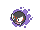
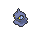
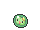
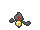
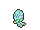

<!-- This file is generated by tools/generate_site.py. Edit the generator, not this file. -->

# Mt. Pyre 1F / 2F

!!! tip "Trainers"

    This area also has trainer battles: see [Mt. Pyre 1F / 2F trainers](../trainers/mt_pyre_1f_2f.md).

## Walking — Lv. 40

| Pokémon | Type | Rate |
| --- | --- | --- |
| { .icon loading=lazy } [Zubat](../pokemon/041.md) | Poison Flying | 10% |
| { .icon loading=lazy } [Gastly](../pokemon/092.md) | Ghost Poison | 10% |
| { .icon loading=lazy } [Ralts](../pokemon/280.md) | Psychic Fairy | 10% |
| { .icon loading=lazy } [Shuppet](../pokemon/353.md) | Ghost | 10% |
| { .icon loading=lazy } [Duskull](../pokemon/355.md) | Ghost | 10% |
| { .icon loading=lazy } [Gothita](../pokemon/574.md) | Psychic | 10% |
| { .icon loading=lazy } [Solosis](../pokemon/577.md) | Psychic | 10% |
| { .icon loading=lazy } [Yamask](../pokemon/562.md) | Ghost | 10% |
| { .icon loading=lazy } [Elgyem](../pokemon/605.md) | Psychic | 10% |
| { .icon loading=lazy } [Litwick](../pokemon/607.md) | Ghost Fire | 10% |

## Horde — Lv. 25

| Pokémon | Type | Rate |
| --- | --- | --- |
| { .icon loading=lazy } [Gastly](../pokemon/092.md) | Ghost Poison | — |

---

[:material-arrow-left: Route 123](route_123.md) · [All areas](index.md) · [Mt. Pyre 3F / 4F :material-arrow-right:](mt_pyre_3f_4f.md)
