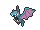
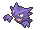
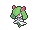
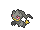
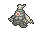
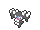
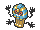
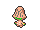

<!-- This file is generated by tools/generate_site.py. Edit the generator, not this file. -->

# Mt. Pyre 3F / 4F

!!! tip "Trainers"

    This area also has trainer battles: see [Mt. Pyre 3F / 4F trainers](../trainers/mt_pyre_3f_4f.md).

## Walking — Lv. 45

| Pokémon | Type | Rate |
| --- | --- | --- |
| { .icon loading=lazy } [Golbat](../pokemon/042.md) | Poison Flying | 10% |
| { .icon loading=lazy } [Haunter](../pokemon/093.md) | Ghost Poison | 10% |
| { .icon loading=lazy } [Kirlia](../pokemon/281.md) | Psychic Fairy | 10% |
| { .icon loading=lazy } [Banette](../pokemon/354.md) | Ghost | 10% |
| { .icon loading=lazy } [Dusclops](../pokemon/356.md) | Ghost | 10% |
| { .icon loading=lazy } [Gothorita](../pokemon/575.md) | Psychic | 10% |
| { .icon loading=lazy } [Duosion](../pokemon/578.md) | Psychic | 10% |
| { .icon loading=lazy } [Cofagrigus](../pokemon/563.md) | Ghost | 10% |
| { .icon loading=lazy } [Beheeyem](../pokemon/606.md) | Psychic | 10% |
| { .icon loading=lazy } [Lampent](../pokemon/608.md) | Ghost Fire | 10% |

## Horde — Lv. 30

| Pokémon | Type | Rate |
| --- | --- | --- |
| { .icon loading=lazy } [Haunter](../pokemon/093.md) | Ghost Poison | — |

---

[:material-arrow-left: Mt. Pyre 1F / 2F](mt_pyre_1f_2f.md) · [All areas](index.md) · [Mt. Pyre Summit 1 :material-arrow-right:](mt_pyre_summit_1.md)
