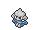

<!-- This file is generated by tools/generate_site.py. Edit the generator, not this file. -->

# Mt. Pyre Summit 1

## Walking — Lv. 40

| Pokémon | Type | Rate |
| --- | --- | --- |
| { .icon loading=lazy } [Spearow](../pokemon/021.md) | Normal Flying | 10% |
| { .icon loading=lazy } [Vulpix](../pokemon/037.md) | Fire | 10% |
| { .icon loading=lazy } [Growlithe](../pokemon/058.md) | Fire | 10% |
| { .icon loading=lazy } [Hoothoot](../pokemon/163.md) | Normal Flying | 10% |
| { .icon loading=lazy } [Natu](../pokemon/177.md) | Psychic Flying | 10% |
| { .icon loading=lazy } [Murkrow](../pokemon/198.md) | Dark Flying | 10% |
| { .icon loading=lazy } [Misdreavus](../pokemon/200.md) | Ghost Fairy | 10% |
| { .icon loading=lazy } [Meditite](../pokemon/307.md) | Fighting Psychic | 10% |
| { .icon loading=lazy } [Bronzor](../pokemon/436.md) | Steel Psychic | 10% |
| { .icon loading=lazy } [Chingling](../pokemon/433.md) | Psychic | 10% |

## DexNav — Lv. 50

| Pokémon | Type | Rate |
| --- | --- | --- |
| { .icon loading=lazy } [Mismagius](../pokemon/429.md) | Ghost Fairy | — |

## Horde — Lv. 25

| Pokémon | Type | Rate |
| --- | --- | --- |
| { .icon loading=lazy } [Bronzor](../pokemon/436.md) | Steel Psychic | — |

---

[:material-arrow-left: Mt. Pyre 3F / 4F](mt_pyre_3f_4f.md) · [All areas](index.md) · [Mt. Pyre Summit 2 :material-arrow-right:](mt_pyre_summit_2.md)
