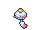

<!-- This file is generated by tools/generate_site.py. Edit the generator, not this file. -->

# Mt. Pyre Summit 2

!!! tip "Trainers"

    This area also has trainer battles: see [Mt. Pyre Summit 2 trainers](../trainers/mt_pyre_summit_2.md).

## Walking — Lv. 45

| Pokémon | Type | Rate |
| --- | --- | --- |
| { .icon loading=lazy } [Fearow](../pokemon/022.md) | Normal Flying | 10% |
| { .icon loading=lazy } [Vulpix](../pokemon/037.md) | Fire | 10% |
| { .icon loading=lazy } [Growlithe](../pokemon/058.md) | Fire | 10% |
| { .icon loading=lazy } [Noctowl](../pokemon/164.md) | Psychic Flying | 10% |
| { .icon loading=lazy } [Xatu](../pokemon/178.md) | Psychic Flying | 10% |
| { .icon loading=lazy } [Murkrow](../pokemon/198.md) | Dark Flying | 10% |
| { .icon loading=lazy } [Misdreavus](../pokemon/200.md) | Ghost Fairy | 10% |
| { .icon loading=lazy } [Medicham](../pokemon/308.md) | Fighting Psychic | 10% |
| { .icon loading=lazy } [Chimecho](../pokemon/358.md) | Psychic | 10% |
| { .icon loading=lazy } [Bronzong](../pokemon/437.md) | Steel Psychic | 10% |

## DexNav — Lv. 50

| Pokémon | Type | Rate |
| --- | --- | --- |
| { .icon loading=lazy } [Ninetales](../pokemon/038.md) | Fire | — |

## Horde — Lv. 30

| Pokémon | Type | Rate |
| --- | --- | --- |
| { .icon loading=lazy } [Bronzor](../pokemon/436.md) | Steel Psychic | — |

---

[:material-arrow-left: Mt. Pyre Summit 1](mt_pyre_summit_1.md) · [All areas](index.md) · [Lilycove City :material-arrow-right:](lilycove_city.md)
