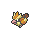
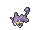

<!-- This file is generated by tools/generate_site.py. Edit the generator, not this file. -->

# Route 101

## Grass — Lv. 5

| Pokémon | Type | Rate |
| --- | --- | --- |
| { .icon loading=lazy } [Pidgey](../pokemon/016.md) | Normal Flying | 10% |
| { .icon loading=lazy } [Rattata](../pokemon/019.md) | Normal | 10% |
| { .icon loading=lazy } [Sentret](../pokemon/161.md) | Normal | 10% |
| { .icon loading=lazy } [Hoothoot](../pokemon/163.md) | Normal Flying | 10% |
| { .icon loading=lazy } [Poochyena](../pokemon/261.md) | Dark | 10% |
| { .icon loading=lazy } [Zigzagoon](../pokemon/263.md) | Normal | 10% |
| { .icon loading=lazy } [Starly](../pokemon/396.md) | Normal Flying | 10% |
| { .icon loading=lazy } [Bidoof](../pokemon/399.md) | Normal | 10% |
| { .icon loading=lazy } [Bunnelby](../pokemon/659.md) | Normal | 10% |
| { .icon loading=lazy } [Fletchling](../pokemon/661.md) | Normal Flying | 10% |

## DexNav — Lv. 50

| Pokémon | Type | Rate |
| --- | --- | --- |
| { .icon loading=lazy } [Linoone](../pokemon/264.md) | Normal | — |

## Horde — Lv. 5

| Pokémon | Type | Rate |
| --- | --- | --- |
| { .icon loading=lazy } [Chikorita](../pokemon/152.md) | Grass | — |
| { .icon loading=lazy } [Fennekin](../pokemon/653.md) | Fire | — |

---

[All areas](index.md) · [Route 103 :material-arrow-right:](route_103.md)
