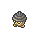
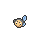

<!-- This file is generated by tools/generate_site.py. Edit the generator, not this file. -->

# Route 102

!!! tip "Trainers"

    This area also has trainer battles: see [Route 102 trainers](../trainers/route_102.md).

## Grass — Lv. 6

| Pokémon | Type | Rate |
| --- | --- | --- |
| { .icon loading=lazy } [Caterpie](../pokemon/010.md) | Bug | 10% |
| { .icon loading=lazy } [Weedle](../pokemon/013.md) | Bug Poison | 10% |
| { .icon loading=lazy } [Bellsprout](../pokemon/069.md) | Grass Poison | 10% |
| { .icon loading=lazy } [Wurmple](../pokemon/265.md) | Bug | 10% |
| { .icon loading=lazy } [Lotad](../pokemon/270.md) | Water Grass | 10% |
| { .icon loading=lazy } [Seedot](../pokemon/273.md) | Grass | 10% |
| { .icon loading=lazy } [Ralts](../pokemon/280.md) | Psychic Fairy | 5% |
| { .icon loading=lazy } [Surskit](../pokemon/283.md) | Bug Water | 5% |
| { .icon loading=lazy } [Tympole](../pokemon/535.md) | Water | 10% |
| { .icon loading=lazy } [Gothita](../pokemon/574.md) | Psychic | 10% |
| { .icon loading=lazy } [Solosis](../pokemon/577.md) | Psychic | 10% |

## DexNav — Lv. 50

| Pokémon | Type | Rate |
| --- | --- | --- |
| { .icon loading=lazy } [Weepinbell](../pokemon/070.md) | Grass Poison | — |

## Horde — Lv. 6

| Pokémon | Type | Rate |
| --- | --- | --- |
| { .icon loading=lazy } [Charmander](../pokemon/004.md) | Fire | — |
| { .icon loading=lazy } [Chespin](../pokemon/650.md) | Grass | — |

## Surfing — Lv. 25 - 35

| Pokémon | Type | Rate |
| --- | --- | --- |
| { .icon loading=lazy } [Surskit](../pokemon/283.md) | Bug Water | — |
| { .icon loading=lazy } [Masquerain](../pokemon/284.md) | Bug Water | — |

## Old Rod — Lv. 15

| Pokémon | Type | Rate |
| --- | --- | --- |
| { .icon loading=lazy } [Corphish](../pokemon/341.md) | Water | — |

## Good Rod — Lv. 35

| Pokémon | Type | Rate |
| --- | --- | --- |
| { .icon loading=lazy } [Corphish](../pokemon/341.md) | Water | — |

## Super Rod — Lv. 55

| Pokémon | Type | Rate |
| --- | --- | --- |
| { .icon loading=lazy } [Crawdaunt](../pokemon/342.md) | Water Dark | — |

---

[:material-arrow-left: Route 103](route_103.md) · [All areas](index.md) · [Petalburg City :material-arrow-right:](petalburg_city.md)
