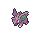
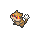

<!-- This file is generated by tools/generate_site.py. Edit the generator, not this file. -->

# Route 103

!!! tip "Trainers"

    This area also has trainer battles: see [Route 103 trainers](../trainers/route_103.md).

## Grass — Lv. 5

| Pokémon | Type | Rate |
| --- | --- | --- |
| { .icon loading=lazy } [Spearow](../pokemon/021.md) | Normal Flying | 10% |
| { .icon loading=lazy } [Nidoran♀](../pokemon/029.md) | Poison | 10% |
| { .icon loading=lazy } [Nidoran♂](../pokemon/032.md) | Poison | 10% |
| { .icon loading=lazy } [Mankey](../pokemon/056.md) | Fighting | 10% |
| { .icon loading=lazy } [Shellos](../pokemon/422.md) | Water | 10% |
| { .icon loading=lazy } [Riolu](../pokemon/447.md) | Fighting | 5% |
| { .icon loading=lazy } [Patrat](../pokemon/504.md) | Normal | 10% |
| { .icon loading=lazy } [Lillipup](../pokemon/506.md) | Normal | 10% |
| { .icon loading=lazy } [Purrloin](../pokemon/509.md) | Dark | 10% |
| { .icon loading=lazy } [Pidove](../pokemon/519.md) | Normal Flying | 10% |
| { .icon loading=lazy } [Zorua](../pokemon/570.md) | Dark | 5% |

## DexNav — Lv. 50

| Pokémon | Type | Rate |
| --- | --- | --- |
| { .icon loading=lazy } [Zoroark](../pokemon/571.md) | Dark | — |

## Horde — Lv. 5

| Pokémon | Type | Rate |
| --- | --- | --- |
| { .icon loading=lazy } [Squirtle](../pokemon/007.md) | Water | — |
| { .icon loading=lazy } [Piplup](../pokemon/393.md) | Water | — |

## Surfing — Lv. 25 - 35

| Pokémon | Type | Rate |
| --- | --- | --- |
| { .icon loading=lazy } [Buizel](../pokemon/418.md) | Water | — |
| { .icon loading=lazy } [Floatzel](../pokemon/419.md) | Water | — |

## Old Rod — Lv. 15

| Pokémon | Type | Rate |
| --- | --- | --- |
| { .icon loading=lazy } [Poliwag](../pokemon/060.md) | Water | — |

## Good Rod — Lv. 35

| Pokémon | Type | Rate |
| --- | --- | --- |
| { .icon loading=lazy } [Poliwag](../pokemon/060.md) | Water | — |

## Super Rod — Lv. 55

| Pokémon | Type | Rate |
| --- | --- | --- |
| { .icon loading=lazy } [Poliwhirl](../pokemon/061.md) | Water | — |

---

[:material-arrow-left: Route 101](route_101.md) · [All areas](index.md) · [Route 102 :material-arrow-right:](route_102.md)
