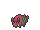

<!-- This file is generated by tools/generate_site.py. Edit the generator, not this file. -->

# Route 104 South

!!! tip "Trainers"

    This area also has trainer battles: see [Route 104 South trainers](../trainers/route_104_south.md).

## Grass — Lv. 8

| Pokémon | Type | Rate |
| --- | --- | --- |
| { .icon loading=lazy } [Psyduck](../pokemon/054.md) | Water | 10% |
| { .icon loading=lazy } [Slowpoke](../pokemon/079.md) | Water Psychic | 10% |
| { .icon loading=lazy } [Exeggcute](../pokemon/102.md) | Grass Psychic | 10% |
| { .icon loading=lazy } [Wingull](../pokemon/278.md) | Water Flying | 10% |
| { .icon loading=lazy } [Taillow](../pokemon/276.md) | Normal Flying | 10% |
| { .icon loading=lazy } [Azurill](../pokemon/298.md) | Normal Fairy | 10% |
| { .icon loading=lazy } [Sewaddle](../pokemon/540.md) | Bug Grass | 10% |
| { .icon loading=lazy } [Venipede](../pokemon/543.md) | Bug Poison | 10% |
| { .icon loading=lazy } [Scraggy](../pokemon/559.md) | Dark Fighting | 10% |
| { .icon loading=lazy } [Spritzee](../pokemon/682.md) | Fairy | 5% |
| { .icon loading=lazy } [Swirlix](../pokemon/684.md) | Fairy | 5% |

## DexNav — Lv. 50

| Pokémon | Type | Rate |
| --- | --- | --- |
| { .icon loading=lazy } [Exeggutor](../pokemon/103.md) | Grass Psychic | — |

## Horde — Lv. 8

| Pokémon | Type | Rate |
| --- | --- | --- |
| { .icon loading=lazy } [Totodile](../pokemon/158.md) | Water | — |
| { .icon loading=lazy } [Oshawott](../pokemon/501.md) | Water | — |

## Surfing — Lv. 25 - 35

| Pokémon | Type | Rate |
| --- | --- | --- |
| { .icon loading=lazy } [Wingull](../pokemon/278.md) | Water Flying | — |

## Old Rod — Lv. 15

| Pokémon | Type | Rate |
| --- | --- | --- |
| { .icon loading=lazy } [Luvdisc](../pokemon/370.md) | Water Fairy | — |

## Good Rod — Lv. 35

| Pokémon | Type | Rate |
| --- | --- | --- |
| { .icon loading=lazy } [Luvdisc](../pokemon/370.md) | Water Fairy | — |

## Super Rod — Lv. 55

| Pokémon | Type | Rate |
| --- | --- | --- |
| { .icon loading=lazy } [Luvdisc](../pokemon/370.md) | Water Fairy | — |

---

[:material-arrow-left: Petalburg City](petalburg_city.md) · [All areas](index.md) · [Petalburg Woods :material-arrow-right:](petalburg_woods.md)
