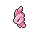
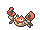
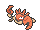

<!-- This file is generated by tools/generate_site.py. Edit the generator, not this file. -->

# Route 105

!!! tip "Trainers"

    This area also has trainer battles: see [Route 105 trainers](../trainers/route_105.md).

## DexNav — Lv. 50

| Pokémon | Type | Rate |
| --- | --- | --- |
| { .icon loading=lazy } [Alomomola](../pokemon/594.md) | Water | — |

## Surfing — Lv. 25 - 35

| Pokémon | Type | Rate |
| --- | --- | --- |
| { .icon loading=lazy } [Wingull](../pokemon/278.md) | Water Flying | — |
| { .icon loading=lazy } [Tentacool](../pokemon/072.md) | Water Poison | — |
| { .icon loading=lazy } [Frillish](../pokemon/592.md) | Water Ghost | — |
| { .icon loading=lazy } [Pelipper](../pokemon/279.md) | Water Flying | — |

## Old Rod — Lv. 15

| Pokémon | Type | Rate |
| --- | --- | --- |
| { .icon loading=lazy } [Krabby](../pokemon/098.md) | Water | — |
| { .icon loading=lazy } [Staryu](../pokemon/120.md) | Water | — |
| { .icon loading=lazy } [Corsola](../pokemon/222.md) | Water Rock | — |

## Good Rod — Lv. 35

| Pokémon | Type | Rate |
| --- | --- | --- |
| { .icon loading=lazy } [Krabby](../pokemon/098.md) | Water | — |
| { .icon loading=lazy } [Staryu](../pokemon/120.md) | Water | — |
| { .icon loading=lazy } [Corsola](../pokemon/222.md) | Water Rock | — |

## Super Rod — Lv. 55

| Pokémon | Type | Rate |
| --- | --- | --- |
| { .icon loading=lazy } [Kingler](../pokemon/099.md) | Water | — |
| { .icon loading=lazy } [Starmie](../pokemon/121.md) | Water Psychic | — |
| { .icon loading=lazy } [Corsola](../pokemon/222.md) | Water Rock | — |

---

[:material-arrow-left: Route 111 (Desert)](route_111_desert.md) · [All areas](index.md) · [Route 108 :material-arrow-right:](route_108.md)
