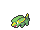
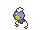

<!-- This file is generated by tools/generate_site.py. Edit the generator, not this file. -->

# Route 110

!!! tip "Trainers"

    This area also has trainer battles: see [Route 110 trainers](../trainers/route_110.md).

## Grass — Lv. 17

| Pokémon | Type | Rate |
| --- | --- | --- |
| { .icon loading=lazy } [Oddish](../pokemon/043.md) | Grass Poison | 10% |
| { .icon loading=lazy } [Magnemite](../pokemon/081.md) | Electric Steel | 10% |
| { .icon loading=lazy } [Voltorb](../pokemon/100.md) | Electric | 10% |
| { .icon loading=lazy } [Wooper](../pokemon/194.md) | Water Ground | 10% |
| { .icon loading=lazy } [Electrike](../pokemon/309.md) | Electric | 10% |
| { .icon loading=lazy } [Gulpin](../pokemon/316.md) | Poison | 10% |
| { .icon loading=lazy } [Drifloon](../pokemon/425.md) | Ghost Flying | 10% |
| { .icon loading=lazy } [Trubbish](../pokemon/568.md) | Poison | 10% |
| { .icon loading=lazy } [Minccino](../pokemon/572.md) | Normal | 10% |
| { .icon loading=lazy } [Skiddo](../pokemon/672.md) | Grass | 10% |

## DexNav — Lv. 50

| Pokémon | Type | Rate |
| --- | --- | --- |
| { .icon loading=lazy } [Cinccino](../pokemon/573.md) | Normal | — |

## Horde — Lv. 12

| Pokémon | Type | Rate |
| --- | --- | --- |
| { .icon loading=lazy } [Plusle](../pokemon/311.md) | Electric | — |
| { .icon loading=lazy } [Minun](../pokemon/312.md) | Electric | — |

## Surfing — Lv. 25 - 35

| Pokémon | Type | Rate |
| --- | --- | --- |
| { .icon loading=lazy } [Wooper](../pokemon/194.md) | Water Ground | — |
| { .icon loading=lazy } [Quagsire](../pokemon/195.md) | Water Ground | — |

## Old Rod — Lv. 20

| Pokémon | Type | Rate |
| --- | --- | --- |
| { .icon loading=lazy } [Remoraid](../pokemon/223.md) | Water | — |
| { .icon loading=lazy } [Qwilfish](../pokemon/211.md) | Water Poison | — |

## Good Rod — Lv. 35

| Pokémon | Type | Rate |
| --- | --- | --- |
| { .icon loading=lazy } [Remoraid](../pokemon/223.md) | Water | — |
| { .icon loading=lazy } [Qwilfish](../pokemon/211.md) | Water Poison | — |

## Super Rod — Lv. 55

| Pokémon | Type | Rate |
| --- | --- | --- |
| { .icon loading=lazy } [Octillery](../pokemon/224.md) | Water | — |
| { .icon loading=lazy } [Qwilfish](../pokemon/211.md) | Water Poison | — |

---

[:material-arrow-left: Slateport City](slateport_city.md) · [All areas](index.md) · [Route 117 :material-arrow-right:](route_117.md)
