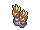

<!-- This file is generated by tools/generate_site.py. Edit the generator, not this file. -->

# Route 111

!!! tip "Trainers"

    This area also has trainer battles: see [Route 111 trainers](../trainers/route_111.md).

## Rock Smash — Lv. 22

| Pokémon | Type | Rate |
| --- | --- | --- |
| { .icon loading=lazy } [Geodude](../pokemon/074.md) | Rock Ground | — |
| { .icon loading=lazy } [Binacle](../pokemon/688.md) | Rock Water | — |

## Surfing — Lv. 25 - 35

| Pokémon | Type | Rate |
| --- | --- | --- |
| { .icon loading=lazy } [Basculin](../pokemon/550.md) | Water | — |

## Old Rod — Lv. 20

| Pokémon | Type | Rate |
| --- | --- | --- |
| { .icon loading=lazy } [Magikarp](../pokemon/129.md) | Water | — |
| { .icon loading=lazy } [Barboach](../pokemon/339.md) | Water Ground | — |

## Good Rod — Lv. 35

| Pokémon | Type | Rate |
| --- | --- | --- |
| { .icon loading=lazy } [Magikarp](../pokemon/129.md) | Water | — |
| { .icon loading=lazy } [Barboach](../pokemon/339.md) | Water Ground | — |

## Super Rod — Lv. 55

| Pokémon | Type | Rate |
| --- | --- | --- |
| { .icon loading=lazy } [Gyarados](../pokemon/130.md) | Water Flying | — |
| { .icon loading=lazy } [Whiscash](../pokemon/340.md) | Water Ground | — |

---

[:material-arrow-left: Granite Cave B2F](granite_cave_b2f.md) · [All areas](index.md) · [Route 112 South :material-arrow-right:](route_112_south.md)
