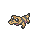
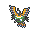
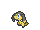

<!-- This file is generated by tools/generate_site.py. Edit the generator, not this file. -->

# Route 111 (Desert)

!!! tip "Trainers"

    This area also has trainer battles: see [Route 111 (Desert) trainers](../trainers/route_111_desert.md).

!!! info "Hint"

    Each Pokémon found regularly in the sand has a 50% chance of holding a particular fossil!

## Grass — Lv. 31

| Pokémon | Type | Rate |
| --- | --- | --- |
| { .icon loading=lazy } [Sandslash](../pokemon/028.md) | Ground | 10% |
| { .icon loading=lazy } [Trapinch](../pokemon/328.md) | Ground | 10% |
| { .icon loading=lazy } [Cacnea](../pokemon/331.md) | Grass | 10% |
| { .icon loading=lazy } [Baltoy](../pokemon/343.md) | Ground Psychic | 10% |
| { .icon loading=lazy } [Gible](../pokemon/443.md) | Dragon Ground | 10% |
| { .icon loading=lazy } [Hippopotas](../pokemon/449.md) | Ground | 10% |
| { .icon loading=lazy } [Sandile](../pokemon/551.md) | Ground Dark | 10% |
| { .icon loading=lazy } [Darumaka](../pokemon/554.md) | Fire | 10% |
| { .icon loading=lazy } [Maractus](../pokemon/556.md) | Grass | 5% |
| { .icon loading=lazy } [Sigilyph](../pokemon/561.md) | Psychic Flying | 5% |
| { .icon loading=lazy } [Helioptile](../pokemon/694.md) | Electric Normal | 10% |

## DexNav — Lv. 50

| Pokémon | Type | Rate |
| --- | --- | --- |
| { .icon loading=lazy } [Vibrava](../pokemon/329.md) | Ground Dragon | — |

## Horde — Lv. 18

| Pokémon | Type | Rate |
| --- | --- | --- |
| { .icon loading=lazy } [Sandshrew](../pokemon/027.md) | Ground | — |

---

[:material-arrow-left: Jagged Pass](jagged_pass.md) · [All areas](index.md) · [Route 105 :material-arrow-right:](route_105.md)
