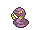
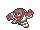
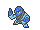

<!-- This file is generated by tools/generate_site.py. Edit the generator, not this file. -->

# Route 112 North

!!! tip "Trainers"

    This area also has trainer battles: see [Route 112 North trainers](../trainers/route_112_north.md).

## Grass — Lv. 24

| Pokémon | Type | Rate |
| --- | --- | --- |
| { .icon loading=lazy } [Ekans](../pokemon/023.md) | Poison | 10% |
| { .icon loading=lazy } [Vulpix](../pokemon/037.md) | Fire | 10% |
| { .icon loading=lazy } [Pinsir](../pokemon/127.md) | Bug | 10% |
| { .icon loading=lazy } [Heracross](../pokemon/214.md) | Bug Fighting | 10% |
| { .icon loading=lazy } [Elekid](../pokemon/239.md) | Electric | 10% |
| { .icon loading=lazy } [Magby](../pokemon/240.md) | Fire | 10% |
| { .icon loading=lazy } [Throh](../pokemon/538.md) | Fighting | 10% |
| { .icon loading=lazy } [Sawk](../pokemon/539.md) | Fighting | 10% |
| { .icon loading=lazy } [Mienfoo](../pokemon/619.md) | Fighting | 10% |
| { .icon loading=lazy } [Pawniard](../pokemon/624.md) | Dark Steel | 10% |

## DexNav — Lv. 50

| Pokémon | Type | Rate |
| --- | --- | --- |
| { .icon loading=lazy } [Ninetales](../pokemon/038.md) | Fire | — |

## Horde — Lv. 15

| Pokémon | Type | Rate |
| --- | --- | --- |
| { .icon loading=lazy } [Tyrogue](../pokemon/236.md) | Fighting | — |

---

[:material-arrow-left: Fiery Path](fiery_path.md) · [All areas](index.md) · [Route 113 :material-arrow-right:](route_113.md)
