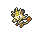
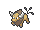
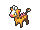
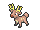
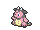

<!-- This file is generated by tools/generate_site.py. Edit the generator, not this file. -->

# Route 112 South

!!! tip "Trainers"

    This area also has trainer battles: see [Route 112 South trainers](../trainers/route_112_south.md).

## Grass — Lv. 23

| Pokémon | Type | Rate |
| --- | --- | --- |
| { .icon loading=lazy } [Meowth](../pokemon/052.md) | Normal | 10% |
| { .icon loading=lazy } [Ponyta](../pokemon/077.md) | Fire | 10% |
| { .icon loading=lazy } [Scyther](../pokemon/123.md) | Bug Flying | 10% |
| { .icon loading=lazy } [Tauros](../pokemon/128.md) | Normal | 10% |
| { .icon loading=lazy } [Girafarig](../pokemon/203.md) | Normal Psychic | 10% |
| { .icon loading=lazy } [Stantler](../pokemon/234.md) | Normal | 10% |
| { .icon loading=lazy } [Miltank](../pokemon/241.md) | Normal | 10% |
| { .icon loading=lazy } [Blitzle](../pokemon/522.md) | Electric | 10% |
| { .icon loading=lazy } [Heatmor](../pokemon/631.md) | Fire | 10% |
| { .icon loading=lazy } [Durant](../pokemon/632.md) | Bug Steel | 10% |

## DexNav — Lv. 50

| Pokémon | Type | Rate |
| --- | --- | --- |
| { .icon loading=lazy } [Scizor](../pokemon/212.md) | Bug Steel | — |

## Horde — Lv. 15

| Pokémon | Type | Rate |
| --- | --- | --- |
| { .icon loading=lazy } [Durant](../pokemon/632.md) | Bug Steel | — |

---

[:material-arrow-left: Route 111](route_111.md) · [All areas](index.md) · [Fiery Path :material-arrow-right:](fiery_path.md)
