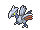
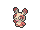
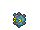
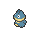
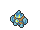
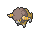
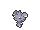

<!-- This file is generated by tools/generate_site.py. Edit the generator, not this file. -->

# Route 113

!!! tip "Trainers"

    This area also has trainer battles: see [Route 113 trainers](../trainers/route_113.md).

## Grass — Lv. 24

| Pokémon | Type | Rate |
| --- | --- | --- |
| { .icon loading=lazy } [Sandshrew](../pokemon/027.md) | Ground | 10% |
| { .icon loading=lazy } [Skarmory](../pokemon/227.md) | Steel Flying | 10% |
| { .icon loading=lazy } [Spinda](../pokemon/327.md) | Normal | 10% |
| { .icon loading=lazy } [Bronzor](../pokemon/436.md) | Steel Psychic | 10% |
| { .icon loading=lazy } [Munchlax](../pokemon/446.md) | Normal | 10% |
| { .icon loading=lazy } [Golett](../pokemon/622.md) | Ground Ghost | 10% |
| { .icon loading=lazy } [Bouffalant](../pokemon/626.md) | Normal | 10% |
| { .icon loading=lazy } [Espurr](../pokemon/677.md) | Psychic | 10% |
| { .icon loading=lazy } [Honedge](../pokemon/679.md) | Steel Ghost | 10% |
| { .icon loading=lazy } [Klefki](../pokemon/707.md) | Steel Fairy | 10% |

## DexNav — Lv. 50

| Pokémon | Type | Rate |
| --- | --- | --- |
| { .icon loading=lazy } [Snorlax](../pokemon/143.md) | Normal | — |

## Horde — Lv. 15

| Pokémon | Type | Rate |
| --- | --- | --- |
| { .icon loading=lazy } [Skarmory](../pokemon/227.md) | Steel Flying | — |

---

[:material-arrow-left: Route 112 North](route_112_north.md) · [All areas](index.md) · [Route 114 :material-arrow-right:](route_114.md)
