<!-- This file is generated by tools/generate_site.py. Edit the generator, not this file. -->

# Route 114

!!! tip "Trainers"

    This area also has trainer battles: see [Route 114 trainers](../trainers/route_114.md).

## Grass — Lv. 25

| Pokémon | Type | Rate |
| --- | --- | --- |
| 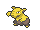{ .icon loading=lazy } [Drowzee](../pokemon/096.md) | Psychic | 10% |
| 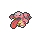{ .icon loading=lazy } [Lickitung](../pokemon/108.md) | Normal | 10% |
| 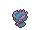{ .icon loading=lazy } [Misdreavus](../pokemon/200.md) | Ghost Fairy | 10% |
| 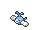{ .icon loading=lazy } [Swablu](../pokemon/333.md) | Normal Flying | 10% |
| { .icon loading=lazy } [Zangoose](../pokemon/335.md) | Normal | 10% |
| { .icon loading=lazy } [Seviper](../pokemon/336.md) | Poison | 10% |
| 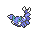{ .icon loading=lazy } [Skorupi](../pokemon/451.md) | Poison Bug | 10% |
| 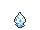{ .icon loading=lazy } [Vanillite](../pokemon/582.md) | Ice | 10% |
| 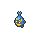{ .icon loading=lazy } [Karrablast](../pokemon/588.md) | Bug | 10% |
| 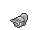{ .icon loading=lazy } [Shelmet](../pokemon/616.md) | Bug | 10% |

## Rock Smash — Lv. 25

| Pokémon | Type | Rate |
| --- | --- | --- |
| 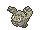{ .icon loading=lazy } [Graveler](../pokemon/075.md) | Rock Ground | — |
| 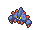{ .icon loading=lazy } [Boldore](../pokemon/525.md) | Rock | — |

## DexNav — Lv. 50

| Pokémon | Type | Rate |
| --- | --- | --- |
| 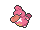{ .icon loading=lazy } [Lickilicky](../pokemon/463.md) | Normal | — |

## Horde — Lv. 15

| Pokémon | Type | Rate |
| --- | --- | --- |
| { .icon loading=lazy } [Vanillite](../pokemon/582.md) | Ice | — |

## Surfing — Lv. 25 - 35

| Pokémon | Type | Rate |
| --- | --- | --- |
| 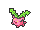{ .icon loading=lazy } [Hoppip](../pokemon/187.md) | Grass Flying | — |
| 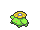{ .icon loading=lazy } [Skiploom](../pokemon/188.md) | Grass Flying | — |

## Old Rod — Lv. 25

| Pokémon | Type | Rate |
| --- | --- | --- |
| 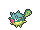{ .icon loading=lazy } [Qwilfish](../pokemon/211.md) | Water Poison | — |

## Good Rod — Lv. 35

| Pokémon | Type | Rate |
| --- | --- | --- |
| { .icon loading=lazy } [Qwilfish](../pokemon/211.md) | Water Poison | — |

## Super Rod — Lv. 55

| Pokémon | Type | Rate |
| --- | --- | --- |
| { .icon loading=lazy } [Qwilfish](../pokemon/211.md) | Water Poison | — |

---

[:material-arrow-left: Route 113](route_113.md) · [All areas](index.md) · [Meteor Falls 1F :material-arrow-right:](meteor_falls_1f.md)
