<!-- This file is generated by tools/generate_site.py. Edit the generator, not this file. -->

# Route 116

!!! tip "Trainers"

    This area also has trainer battles: see [Route 116 trainers](../trainers/route_116.md).

## Grass — Lv. 10

| Pokémon | Type | Rate |
| --- | --- | --- |
| 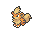{ .icon loading=lazy } [Growlithe](../pokemon/058.md) | Fire | 10% |
| 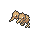{ .icon loading=lazy } [Doduo](../pokemon/084.md) | Normal Flying | 10% |
| 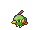{ .icon loading=lazy } [Natu](../pokemon/177.md) | Psychic Flying | 10% |
| 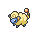{ .icon loading=lazy } [Mareep](../pokemon/179.md) | Electric | 10% |
| 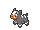{ .icon loading=lazy } [Houndour](../pokemon/228.md) | Dark Fire | 10% |
| 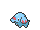{ .icon loading=lazy } [Phanpy](../pokemon/231.md) | Ground | 10% |
| 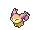{ .icon loading=lazy } [Skitty](../pokemon/300.md) | Normal | 5% |
| 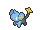{ .icon loading=lazy } [Shinx](../pokemon/403.md) | Electric | 10% |
| 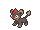{ .icon loading=lazy } [Litleo](../pokemon/667.md) | Fire Normal | 10% |
| 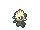{ .icon loading=lazy } [Pancham](../pokemon/674.md) | Fighting | 10% |
| 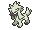{ .icon loading=lazy } [Furfrou](../pokemon/676.md) | Normal | 5% |

## DexNav — Lv. 50

| Pokémon | Type | Rate |
| --- | --- | --- |
| 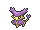{ .icon loading=lazy } [Delcatty](../pokemon/301.md) | Normal | — |

## Horde — Lv. 10

| Pokémon | Type | Rate |
| --- | --- | --- |
| 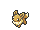{ .icon loading=lazy } [Eevee](../pokemon/133.md) | Normal | — |

---

[:material-arrow-left: Route 104 North](route_104_north.md) · [All areas](index.md) · [Rusturf Tunnel :material-arrow-right:](rusturf_tunnel.md)
