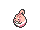

<!-- This file is generated by tools/generate_site.py. Edit the generator, not this file. -->

# Route 117

!!! tip "Trainers"

    This area also has trainer battles: see [Route 117 trainers](../trainers/route_117.md).

## Grass — Lv. 18

| Pokémon | Type | Rate |
| --- | --- | --- |
| { .icon loading=lazy } [Farfetch’d](../pokemon/083.md) | Fighting Flying | 5% |
| { .icon loading=lazy } [Smeargle](../pokemon/235.md) | Normal | 10% |
| { .icon loading=lazy } [Volbeat](../pokemon/313.md) | Bug Fairy | 10% |
| { .icon loading=lazy } [Illumise](../pokemon/314.md) | Bug Fairy | 10% |
| { .icon loading=lazy } [Roselia](../pokemon/315.md) | Grass Poison | 10% |
| { .icon loading=lazy } [Cherubi](../pokemon/420.md) | Grass | 10% |
| { .icon loading=lazy } [Bonsly](../pokemon/438.md) | Rock | 10% |
| { .icon loading=lazy } [Mime Jr.](../pokemon/439.md) | Psychic Fairy | 10% |
| { .icon loading=lazy } [Chansey](../pokemon/113.md) | Normal | 5% |
| { .icon loading=lazy } [Ducklett](../pokemon/580.md) | Water Flying | 10% |
| { .icon loading=lazy } [Deerling](../pokemon/585.md) | Normal Grass | 10% |

## DexNav — Lv. 50

| Pokémon | Type | Rate |
| --- | --- | --- |
| { .icon loading=lazy } [Sawsbuck](../pokemon/586.md) | Normal Grass | — |

## Horde — Lv. 12

| Pokémon | Type | Rate |
| --- | --- | --- |
| { .icon loading=lazy } [Happiny](../pokemon/440.md) | Normal | — |

## Surfing — Lv. 25 - 35

| Pokémon | Type | Rate |
| --- | --- | --- |
| { .icon loading=lazy } [Ducklett](../pokemon/580.md) | Water Flying | — |
| { .icon loading=lazy } [Swanna](../pokemon/581.md) | Water Flying | — |

## Old Rod — Lv. 20

| Pokémon | Type | Rate |
| --- | --- | --- |
| { .icon loading=lazy } [Poliwag](../pokemon/060.md) | Water | — |

## Good Rod — Lv. 35

| Pokémon | Type | Rate |
| --- | --- | --- |
| { .icon loading=lazy } [Poliwag](../pokemon/060.md) | Water | — |

## Super Rod — Lv. 55

| Pokémon | Type | Rate |
| --- | --- | --- |
| { .icon loading=lazy } [Poliwhirl](../pokemon/061.md) | Water | — |

---

[:material-arrow-left: Route 110](route_110.md) · [All areas](index.md) · [Granite Cave B1F :material-arrow-right:](granite_cave_b1f.md)
