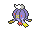
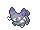
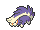
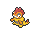
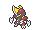
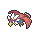
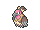
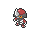

<!-- This file is generated by tools/generate_site.py. Edit the generator, not this file. -->

# Route 120 South-West

!!! tip "Trainers"

    This area also has trainer battles: see [Route 120 South-West trainers](../trainers/route_120_south_west.md).

## Tall Grass — Lv. 44

| Pokémon | Type | Rate |
| --- | --- | --- |
| { .icon loading=lazy } [Altaria](../pokemon/334.md) | Dragon Flying | 10% |
| { .icon loading=lazy } [Absol](../pokemon/359.md) | Dark | 10% |
| { .icon loading=lazy } [Drifblim](../pokemon/426.md) | Ghost Flying | 10% |
| { .icon loading=lazy } [Purugly](../pokemon/432.md) | Normal | 10% |
| { .icon loading=lazy } [Skuntank](../pokemon/435.md) | Poison Dark | 10% |
| { .icon loading=lazy } [Scrafty](../pokemon/560.md) | Dark Fighting | 10% |
| { .icon loading=lazy } [Mienshao](../pokemon/620.md) | Fighting | 10% |
| { .icon loading=lazy } [Bisharp](../pokemon/625.md) | Dark Steel | 10% |
| { .icon loading=lazy } [Braviary](../pokemon/628.md) | Normal Flying | 10% |
| { .icon loading=lazy } [Mandibuzz](../pokemon/630.md) | Dark Flying | 10% |

## Horde — Lv. 25

| Pokémon | Type | Rate |
| --- | --- | --- |
| { .icon loading=lazy } [Pawniard](../pokemon/624.md) | Dark Steel | — |

## Surfing — Lv. 35 - 45

| Pokémon | Type | Rate |
| --- | --- | --- |
| { .icon loading=lazy } [Buizel](../pokemon/418.md) | Water | — |
| { .icon loading=lazy } [Floatzel](../pokemon/419.md) | Water | — |

## Old Rod — Lv. 15

| Pokémon | Type | Rate |
| --- | --- | --- |
| { .icon loading=lazy } [Barboach](../pokemon/339.md) | Water Ground | — |

## Good Rod — Lv. 35

| Pokémon | Type | Rate |
| --- | --- | --- |
| { .icon loading=lazy } [Barboach](../pokemon/339.md) | Water Ground | — |

## Super Rod — Lv. 55

| Pokémon | Type | Rate |
| --- | --- | --- |
| { .icon loading=lazy } [Whiscash](../pokemon/340.md) | Water Ground | — |

---

[:material-arrow-left: Scorched Slab Basement](scorched_slab_basement.md) · [All areas](index.md) · [Route 121 :material-arrow-right:](route_121.md)
