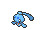

<!-- This file is generated by tools/generate_site.py. Edit the generator, not this file. -->

# Route 134

!!! tip "Trainers"

    This area also has trainer battles: see [Route 134 trainers](../trainers/route_134.md).

## DexNav — Lv. 50

| Pokémon | Type | Rate |
| --- | --- | --- |
| { .icon loading=lazy } [Kingdra](../pokemon/230.md) | Water Dragon | — |

## Surfing — Lv. 40

| Pokémon | Type | Rate |
| --- | --- | --- |
| { .icon loading=lazy } [Phione](../pokemon/489.md) | Water | — |

## Old Rod — Lv. 15

| Pokémon | Type | Rate |
| --- | --- | --- |
| { .icon loading=lazy } [Horsea](../pokemon/116.md) | Water | — |
| { .icon loading=lazy } [Dratini](../pokemon/147.md) | Dragon | — |

## Good Rod — Lv. 35

| Pokémon | Type | Rate |
| --- | --- | --- |
| { .icon loading=lazy } [Horsea](../pokemon/116.md) | Water | — |
| { .icon loading=lazy } [Dratini](../pokemon/147.md) | Dragon | — |

## Super Rod — Lv. 55

| Pokémon | Type | Rate |
| --- | --- | --- |
| { .icon loading=lazy } [Seadra](../pokemon/117.md) | Water | — |
| { .icon loading=lazy } [Dragonair](../pokemon/148.md) | Dragon | — |

---

[:material-arrow-left: Route 133](route_133.md) · [All areas](index.md) · [Underwater 107 :material-arrow-right:](underwater_107.md)
