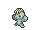
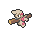

<!-- This file is generated by tools/generate_site.py. Edit the generator, not this file. -->

# Rusturf Tunnel

!!! tip "Trainers"

    This area also has trainer battles: see [Rusturf Tunnel trainers](../trainers/rusturf_tunnel.md).

## Walking — Lv. 10

| Pokémon | Type | Rate |
| --- | --- | --- |
| { .icon loading=lazy } [Paras](../pokemon/046.md) | Bug Grass | 10% |
| { .icon loading=lazy } [Machop](../pokemon/066.md) | Fighting | 10% |
| { .icon loading=lazy } [Gastly](../pokemon/092.md) | Ghost Poison | 10% |
| { .icon loading=lazy } [Spinarak](../pokemon/167.md) | Bug Poison | 10% |
| { .icon loading=lazy } [Teddiursa](../pokemon/216.md) | Normal | 10% |
| { .icon loading=lazy } [Nincada](../pokemon/290.md) | Bug Ground | 10% |
| { .icon loading=lazy } [Whismur](../pokemon/293.md) | Normal | 10% |
| { .icon loading=lazy } [Drilbur](../pokemon/529.md) | Ground | 10% |
| { .icon loading=lazy } [Timburr](../pokemon/532.md) | Fighting | 10% |
| { .icon loading=lazy } [Joltik](../pokemon/595.md) | Bug Electric | 10% |

## Rock Smash — Lv. 20

| Pokémon | Type | Rate |
| --- | --- | --- |
| { .icon loading=lazy } [Geodude](../pokemon/074.md) | Rock Ground | — |
| { .icon loading=lazy } [Dwebble](../pokemon/557.md) | Bug Rock | — |

## Horde — Lv. 10

| Pokémon | Type | Rate |
| --- | --- | --- |
| { .icon loading=lazy } [Cyndaquil](../pokemon/155.md) | Fire | — |
| { .icon loading=lazy } [Chimchar](../pokemon/390.md) | Fire | — |

---

[:material-arrow-left: Route 116](route_116.md) · [All areas](index.md) · [Route 106 :material-arrow-right:](route_106.md)
