<!-- This file is generated by tools/generate_site.py. Edit the generator, not this file. -->

# Safari Zone (4)

## Grass — Lv. 45

| Pokémon | Type | Rate |
| --- | --- | --- |
| 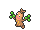{ .icon loading=lazy } [Sudowoodo](../pokemon/185.md) | Rock | — |
| 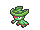{ .icon loading=lazy } [Lombre](../pokemon/271.md) | Water Grass | — |
| 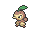{ .icon loading=lazy } [Nuzleaf](../pokemon/274.md) | Grass Dark | — |
| 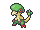{ .icon loading=lazy } [Breloom](../pokemon/286.md) | Grass Fighting | — |
| 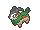{ .icon loading=lazy } [Gogoat](../pokemon/673.md) | Grass | — |

## Tall Grass — Lv. 45

| Pokémon | Type | Rate |
| --- | --- | --- |
| 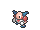{ .icon loading=lazy } [Mr. Mime](../pokemon/122.md) | Psychic Fairy | — |
| { .icon loading=lazy } [Wobbuffet](../pokemon/202.md) | Psychic | — |
| 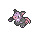{ .icon loading=lazy } [Grumpig](../pokemon/326.md) | Psychic | — |
| 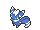{ .icon loading=lazy } [Meowstic](../pokemon/678.md) | Psychic | — |
| 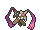{ .icon loading=lazy } [Doublade](../pokemon/680.md) | Steel Ghost | — |

## DexNav — Lv. 50

| Pokémon | Type | Rate |
| --- | --- | --- |
| 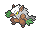{ .icon loading=lazy } [Shiftry](../pokemon/275.md) | Grass Dark | — |

## Horde — Lv. 30

| Pokémon | Type | Rate |
| --- | --- | --- |
| 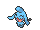{ .icon loading=lazy } [Wynaut](../pokemon/360.md) | Psychic | — |

## Surfing — Lv. 40 - 45

| Pokémon | Type | Rate |
| --- | --- | --- |
| { .icon loading=lazy } [Quagsire](../pokemon/195.md) | Water Ground | — |

## Old Rod — Lv. 15

| Pokémon | Type | Rate |
| --- | --- | --- |
| 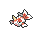{ .icon loading=lazy } [Goldeen](../pokemon/118.md) | Water | — |

## Good Rod — Lv. 35

| Pokémon | Type | Rate |
| --- | --- | --- |
| { .icon loading=lazy } [Goldeen](../pokemon/118.md) | Water | — |

## Super Rod — Lv. 55

| Pokémon | Type | Rate |
| --- | --- | --- |
| { .icon loading=lazy } [Seaking](../pokemon/119.md) | Water | — |

---

[:material-arrow-left: Safari Zone (3)](safari_zone_3.md) · [All areas](index.md) · [Route 122 :material-arrow-right:](route_122.md)
