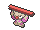

<!-- This file is generated by tools/generate_site.py. Edit the generator, not this file. -->

# Scorched Slab Basement

## Walking — Lv. 40

| Pokémon | Type | Rate |
| --- | --- | --- |
| { .icon loading=lazy } [Golbat](../pokemon/042.md) | Poison Flying | 10% |
| { .icon loading=lazy } [Rhydon](../pokemon/112.md) | Ground Rock | 10% |
| { .icon loading=lazy } [Steelix](../pokemon/208.md) | Steel Ground | 10% |
| { .icon loading=lazy } [Lairon](../pokemon/305.md) | Steel Rock | 10% |
| { .icon loading=lazy } [Swoobat](../pokemon/528.md) | Psychic Flying | 10% |
| { .icon loading=lazy } [Excadrill](../pokemon/530.md) | Ground Steel | 10% |
| { .icon loading=lazy } [Gurdurr](../pokemon/533.md) | Fighting | 10% |
| { .icon loading=lazy } [Fraxure](../pokemon/611.md) | Dragon | 10% |
| { .icon loading=lazy } [Volcarona](../pokemon/637.md) | Bug Fire | 10% |
| { .icon loading=lazy } [Noivern](../pokemon/715.md) | Flying Dragon | 10% |

## Horde — Lv. 25

| Pokémon | Type | Rate |
| --- | --- | --- |
| { .icon loading=lazy } [Golbat](../pokemon/042.md) | Poison Flying | — |

## Surfing — Lv. 35 - 45

| Pokémon | Type | Rate |
| --- | --- | --- |
| { .icon loading=lazy } [Buizel](../pokemon/418.md) | Water | — |
| { .icon loading=lazy } [Floatzel](../pokemon/419.md) | Water | — |

## Old Rod — Lv. 15

| Pokémon | Type | Rate |
| --- | --- | --- |
| { .icon loading=lazy } [Barboach](../pokemon/339.md) | Water Ground | — |

## Good Rod — Lv. 35

| Pokémon | Type | Rate |
| --- | --- | --- |
| { .icon loading=lazy } [Barboach](../pokemon/339.md) | Water Ground | — |

## Super Rod — Lv. 55

| Pokémon | Type | Rate |
| --- | --- | --- |
| { .icon loading=lazy } [Whiscash](../pokemon/340.md) | Water Ground | — |

---

[:material-arrow-left: Scorched Slab](scorched_slab.md) · [All areas](index.md) · [Route 120 South-West :material-arrow-right:](route_120_south_west.md)
