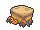
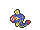

<!-- This file is generated by tools/generate_site.py. Edit the generator, not this file. -->

# Seafloor Cavern Water Rooms

## Walking — Lv. 56

| Pokémon | Type | Rate |
| --- | --- | --- |
| { .icon loading=lazy } [Golbat](../pokemon/042.md) | Poison Flying | — |
| { .icon loading=lazy } [Aerodactyl](../pokemon/142.md) | Rock Flying | — |
| { .icon loading=lazy } [Swoobat](../pokemon/528.md) | Psychic Flying | — |
| { .icon loading=lazy } [Crustle](../pokemon/558.md) | Bug Rock | — |
| { .icon loading=lazy } [Eelektrik](../pokemon/603.md) | Electric | — |
| { .icon loading=lazy } [Noivern](../pokemon/715.md) | Flying Dragon | — |

## Horde — Lv. 35

| Pokémon | Type | Rate |
| --- | --- | --- |
| { .icon loading=lazy } [Golbat](../pokemon/042.md) | Poison Flying | — |

## Surfing — Lv. 45 - 55

| Pokémon | Type | Rate |
| --- | --- | --- |
| { .icon loading=lazy } [Tentacruel](../pokemon/073.md) | Water Poison | — |
| { .icon loading=lazy } [Jellicent](../pokemon/593.md) | Water Ghost | — |

## Old Rod — Lv. 15

| Pokémon | Type | Rate |
| --- | --- | --- |
| { .icon loading=lazy } [Relicanth](../pokemon/369.md) | Water Rock | — |

## Good Rod — Lv. 35

| Pokémon | Type | Rate |
| --- | --- | --- |
| { .icon loading=lazy } [Relicanth](../pokemon/369.md) | Water Rock | — |

## Super Rod — Lv. 55

| Pokémon | Type | Rate |
| --- | --- | --- |
| { .icon loading=lazy } [Relicanth](../pokemon/369.md) | Water Rock | — |

---

[:material-arrow-left: Seafloor Cavern Front Rooms](seafloor_cavern_front_rooms.md) · [All areas](index.md) · [Seafloor Cavern Back Rooms :material-arrow-right:](seafloor_cavern_back_rooms.md)
