<!-- This file is generated by tools/generate_site.py. Edit the generator, not this file. -->

# Shoal Cave 1F

## Walking — Lv. 40

| Pokémon | Type | Rate |
| --- | --- | --- |
| { .icon loading=lazy } [Sneasel](../pokemon/215.md) | Dark Ice | 10% |
| 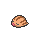{ .icon loading=lazy } [Swinub](../pokemon/220.md) | Ice Ground | 10% |
| 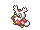{ .icon loading=lazy } [Delibird](../pokemon/225.md) | Ice Flying | 10% |
| 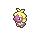{ .icon loading=lazy } [Smoochum](../pokemon/238.md) | Ice Psychic | 10% |
| 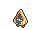{ .icon loading=lazy } [Snorunt](../pokemon/361.md) | Ice | 10% |
| 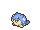{ .icon loading=lazy } [Spheal](../pokemon/363.md) | Ice Water | 10% |
| 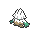{ .icon loading=lazy } [Snover](../pokemon/459.md) | Grass Ice | 10% |
| { .icon loading=lazy } [Vanillite](../pokemon/582.md) | Ice | 10% |
| 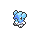{ .icon loading=lazy } [Cubchoo](../pokemon/613.md) | Ice | 10% |
| 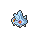{ .icon loading=lazy } [Bergmite](../pokemon/712.md) | Ice | 10% |

## DexNav — Lv. 50

| Pokémon | Type | Rate |
| --- | --- | --- |
| { .icon loading=lazy } [Weavile](../pokemon/461.md) | Dark Ice | — |

## Horde — Lv. 25

| Pokémon | Type | Rate |
| --- | --- | --- |
| { .icon loading=lazy } [Bergmite](../pokemon/712.md) | Ice | — |

## Surfing — Lv. 40 - 50

| Pokémon | Type | Rate |
| --- | --- | --- |
| 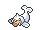{ .icon loading=lazy } [Seel](../pokemon/086.md) | Water | — |
| 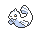{ .icon loading=lazy } [Dewgong](../pokemon/087.md) | Water Ice | — |

## Old Rod — Lv. 15

| Pokémon | Type | Rate |
| --- | --- | --- |
| 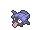{ .icon loading=lazy } [Shellder](../pokemon/090.md) | Water | — |

## Good Rod — Lv. 35

| Pokémon | Type | Rate |
| --- | --- | --- |
| { .icon loading=lazy } [Shellder](../pokemon/090.md) | Water | — |

## Super Rod — Lv. 55

| Pokémon | Type | Rate |
| --- | --- | --- |
| { .icon loading=lazy } [Cloyster](../pokemon/091.md) | Water Ice | — |

---

[:material-arrow-left: Route 125](route_125.md) · [All areas](index.md) · [Shoal Cave B1F, B2F, B3F :material-arrow-right:](shoal_cave_b1f_b2f_b3f.md)
