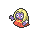
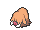
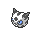
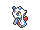
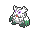
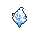
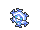
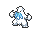
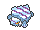

<!-- This file is generated by tools/generate_site.py. Edit the generator, not this file. -->

# Shoal Cave Ice Room

## Walking — Lv. 55

| Pokémon | Type | Rate |
| --- | --- | --- |
| { .icon loading=lazy } [Jynx](../pokemon/124.md) | Ice Psychic | 10% |
| { .icon loading=lazy } [Sneasel](../pokemon/215.md) | Dark Ice | 10% |
| { .icon loading=lazy } [Piloswine](../pokemon/221.md) | Ice Ground | 10% |
| { .icon loading=lazy } [Delibird](../pokemon/225.md) | Ice Flying | 10% |
| { .icon loading=lazy } [Glalie](../pokemon/362.md) | Ice | 5% |
| { .icon loading=lazy } [Froslass](../pokemon/478.md) | Ice Ghost | 5% |
| { .icon loading=lazy } [Abomasnow](../pokemon/460.md) | Grass Ice | 10% |
| { .icon loading=lazy } [Vanillish](../pokemon/583.md) | Ice | 10% |
| { .icon loading=lazy } [Cryogonal](../pokemon/615.md) | Ice | 10% |
| { .icon loading=lazy } [Beartic](../pokemon/614.md) | Ice Fighting | 10% |
| { .icon loading=lazy } [Avalugg](../pokemon/713.md) | Ice | 10% |

## Horde — Lv. 32

| Pokémon | Type | Rate |
| --- | --- | --- |
| { .icon loading=lazy } [Snorunt](../pokemon/361.md) | Ice | — |

---

[:material-arrow-left: Shoal Cave B1F, B2F, B3F](shoal_cave_b1f_b2f_b3f.md) · [All areas](index.md) · [Route 126 :material-arrow-right:](route_126.md)
