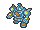

<!-- This file is generated by tools/generate_site.py. Edit the generator, not this file. -->

# Sky Pillar

Post Game

!!! tip "Trainers"

    This area also has trainer battles: see [Sky Pillar trainers](../trainers/sky_pillar.md).

## Walking — Lv. 67

| Pokémon | Type | Rate |
| --- | --- | --- |
| { .icon loading=lazy } [Raticate](../pokemon/020.md) | Normal | 10% |
| { .icon loading=lazy } [Ariados](../pokemon/168.md) | Bug Poison | 10% |
| { .icon loading=lazy } [Altaria](../pokemon/334.md) | Dragon Flying | 10% |
| { .icon loading=lazy } [Claydol](../pokemon/344.md) | Ground Psychic | 10% |
| { .icon loading=lazy } [Spiritomb](../pokemon/442.md) | Ghost Dark | 10% |
| { .icon loading=lazy } [Sigilyph](../pokemon/561.md) | Psychic Flying | 10% |
| { .icon loading=lazy } [Mienshao](../pokemon/620.md) | Fighting | 10% |
| { .icon loading=lazy } [Druddigon](../pokemon/621.md) | Dragon | 10% |
| { .icon loading=lazy } [Golurk](../pokemon/623.md) | Ground Ghost | 10% |
| { .icon loading=lazy } [Noivern](../pokemon/715.md) | Flying Dragon | 10% |

## Horde — Lv. 43

| Pokémon | Type | Rate |
| --- | --- | --- |
| { .icon loading=lazy } [Altaria](../pokemon/334.md) | Dragon Flying | — |

---

[:material-arrow-left: Victory Road 2F](victory_road_2f.md) · [All areas](index.md) · [Battle Resort :material-arrow-right:](battle_resort.md)
