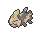

<!-- This file is generated by tools/generate_site.py. Edit the generator, not this file. -->

# Underwater 124

!!! tip "Trainers"

    This area also has trainer battles: see [Underwater 124 trainers](../trainers/underwater_124.md).

## Grass — Lv. 55

| Pokémon | Type | Rate |
| --- | --- | --- |
| { .icon loading=lazy } [Tentacruel](../pokemon/073.md) | Water Poison | 10% |
| { .icon loading=lazy } [Seadra](../pokemon/117.md) | Water | 10% |
| { .icon loading=lazy } [Starmie](../pokemon/121.md) | Water Psychic | 10% |
| { .icon loading=lazy } [Lanturn](../pokemon/171.md) | Water Electric | 10% |
| { .icon loading=lazy } [Corsola](../pokemon/222.md) | Water Rock | 10% |
| { .icon loading=lazy } [Huntail](../pokemon/367.md) | Water | 10% |
| { .icon loading=lazy } [Gorebyss](../pokemon/368.md) | Water | 10% |
| { .icon loading=lazy } [Relicanth](../pokemon/369.md) | Water Rock | 10% |
| { .icon loading=lazy } [Jellicent](../pokemon/593.md) | Water Ghost | 10% |
| { .icon loading=lazy } [Dragalge](../pokemon/691.md) | Poison Dragon | 10% |

---

[:material-arrow-left: Underwater 107](underwater_107.md) · [All areas](index.md) · [Underwater 126 :material-arrow-right:](underwater_126.md)
